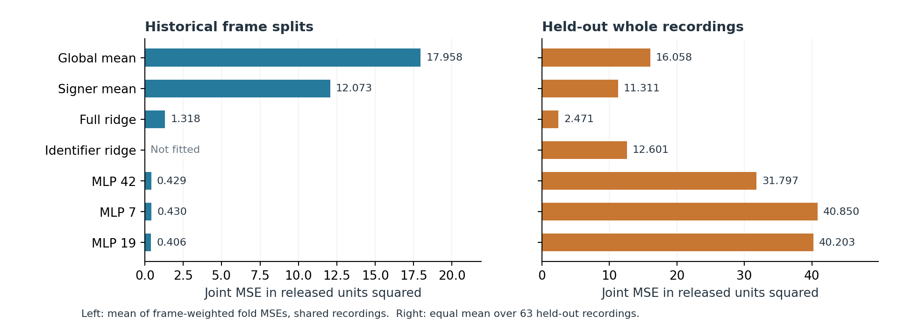

# Eyebrow measurement under head movement

How well do models predict neutral eyebrow distances in new recordings of known signers and sentences? This repository compares ridge regression and multilayer perceptrons (MLPs) using released OpenFace measurements. It tests frame splits that share recordings between training and validation, whole-recording holdout, and an exploratory follow-up with stronger regularization.

A separate Face Landmarker pilot examines whether pitch correction reduces variation in neutral eyebrow measurements while preserving eyebrow raises.

[Read the report (PDF)](docs/eyebrow-measurement-report.pdf).

## Results

The OpenFace experiments use 4,414 neutral frames from 63 recordings and eight signers. Both models use pose, signer, and sentence inputs. Joint mean squared error (MSE) averages the errors for the inner and outer eyebrow-distance targets, in released coordinate units squared. The table reports MLP seed 42.

| Validation | Ridge joint MSE | MLP joint MSE |
|---|---:|---:|
| Frame splits with shared recordings | 1.318 | 0.429 |
| Held-out whole recordings | 2.471 | 31.797 |

Frame-split scores average four frame-weighted fold scores; whole-recording scores weight the 63 held-out recordings equally. The displayed scores therefore use different aggregation weights. Signers and sentence categories are known in both evaluations.

The fixed MLP has lower error than ridge on frame splits and substantially higher error on held-out recordings. In the exploratory follow-up, grouped selection chooses an MLP using pose and signer inputs, with stronger regularization. Its held-out joint MSE is 2.623, compared with 2.471 for fixed ridge and 2.600 for ridge with grouped selection. This follow-up was informed by the fixed experiment's errors; it needs confirmation on fresh recordings. See the [full comparison table](results/openface/mlp-followup/diagnostics/main_table.csv).

[Errors by recording](figures/03_recording_differences.png) · [MLP diagnostics](figures/mlp-followup/diagnostic_figure.png)

The one-participant pilot includes 22 recordings. Within the training pitch range, the generalized additive model (GAM) lowers neutral RMSE at all three camera distances but increases held-raised RMSE. Both the GAM and pilot MLP reduce AUROC for distinguishing annotated raised and neutral states in one close-distance alternating recording. These results do not demonstrate expression preservation. The [pilot summary](results/face-landmarker/summary.csv) reports mean recording-level metrics separately for each camera distance. The [pooled pilot table](results/face-landmarker/pooled_summary.csv) gives equal-recording averages across distances at full numerical precision, with verified recording counts.

## Reproduction

Start with the [reproduction guide](docs/reproduction.md). It covers installation, checking saved OpenFace results, rerunning experiments, and an inference example. OpenFace inputs can be retrieved from pinned sources. Exact pilot replay requires the original local videos, reviewed annotations, and reference intervals; only its aggregate summary is included here.

## Sources and license

OpenFace measurements come from [Kuznetsova et al. (2022)](https://aclanthology.org/2022.signlang-1.19/) and their [input repository](https://github.com/kuzanna2016/non-manuals-2021). The pilot uses videos associated with [Kuznetsova and Kimmelman (2024)](https://arxiv.org/abs/2403.10367v2), available through [OSF](https://osf.io/jvc42/). Further references are in the [bibliography](research/references.bib).

Original code in `src/`, `scripts/`, and `tests/` is licensed under the [MIT License](LICENSE), copyright © 2026 Hareth Al-Jomaa. Datasets, research outputs, figures, fitted model artifacts, and third-party materials are excluded from that grant. See the [data-use notes](docs/reproduction.md#data-use).
